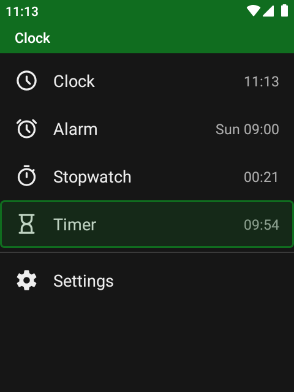
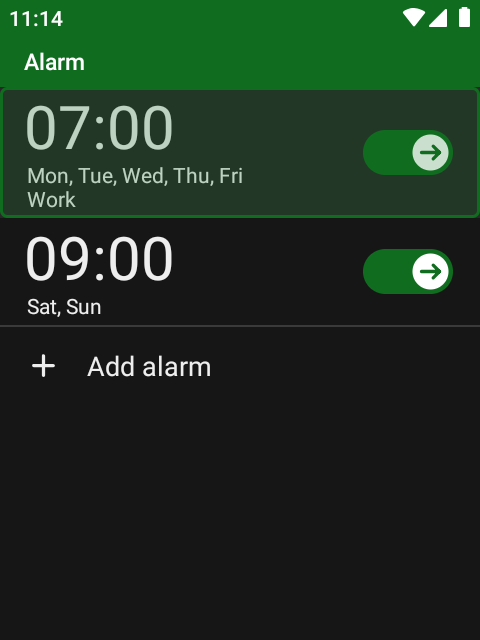
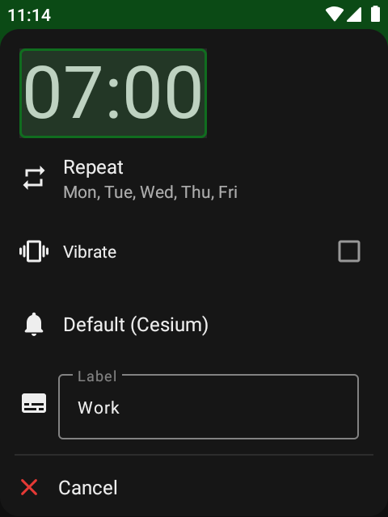
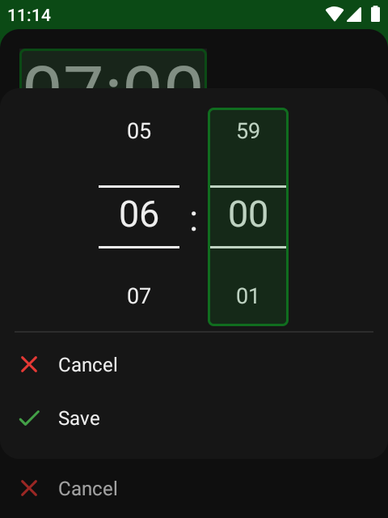
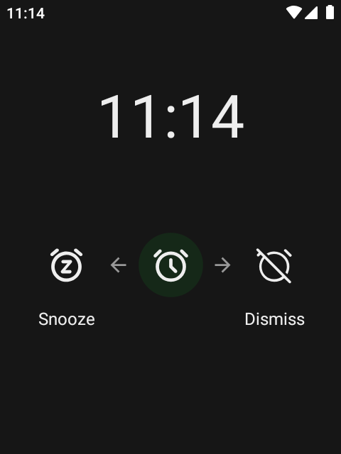
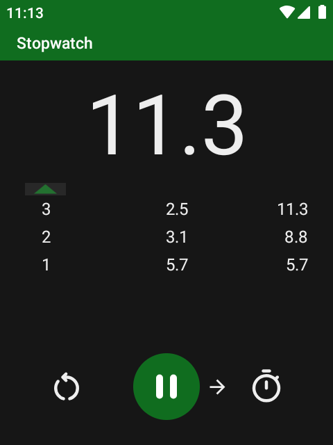
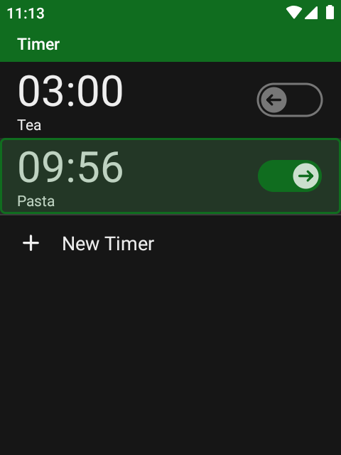
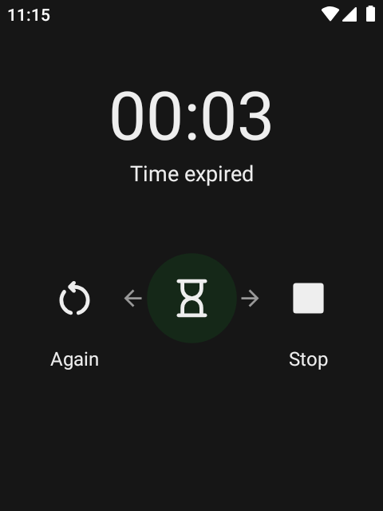
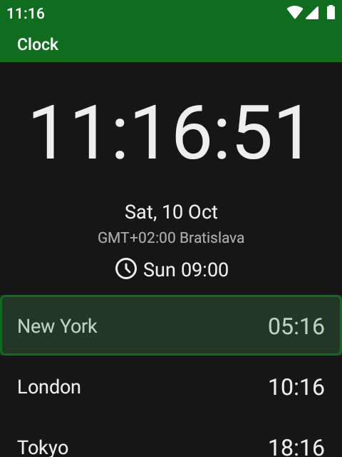
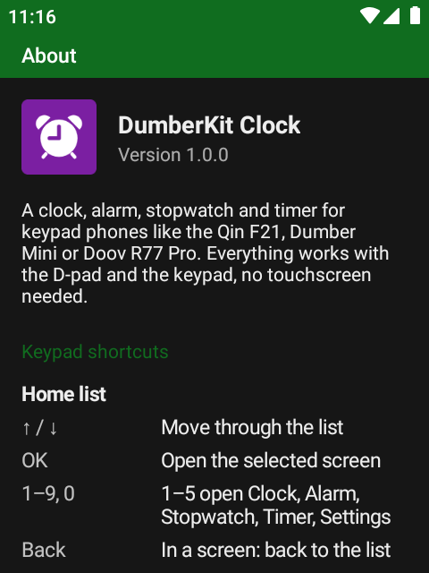

# DumberKit: Clock


[](https://ko-fi.com/lbockaj)

A clock, alarm, stopwatch and timer for **keypad phones** – the Qin F21, Dumber Mini, Doov R77 Pro and other small
Android phones with a D-pad and a T9 keypad. Clock apps are made for fingers: round dials to drag, switches to tap,
alarms you swipe away. Here every screen, list and dialog works with the keys alone, there are no floating buttons
and nothing to swipe, and the layout fits a 480×640 screen.

It's built on [Fossify Clock](https://github.com/FossifyOrg/Clock), so it keeps its alarms, timers, stopwatch, time
zones and themes. Touch is switched off inside the app, so nothing gets pressed by accident in your pocket.

<div align="center">





</div>

## Using it with the keys

The app opens on a list: **Clock**, **Alarm**, **Stopwatch**, **Timer** and, under a line, **Settings**. Next to
them you see the time, the next alarm and a running stopwatch or timer. **↑ / ↓** and **OK** open a screen, or press
**1–5** to open one straight away. **Back** in a screen returns to the list, Back on the list closes the app.

The **Menu** key shows the other actions of the screen you're on (delete, add, sort…), and lists end with a
**+** row to add a new item.

### Alarm

| Key | What it does |
| --- | --- |
| **OK** | Open the alarm's settings |
| **← / →** | Switch the alarm off / on – the switch on the right shows an arrow in the same direction |
| **Hold OK** | Switch on / off, delete |
| **Menu** | Delete the alarm, add one, sort the alarms |
| **+ Add alarm** | The last row of the list |

An alarm's settings are rows you go through with **↑ / ↓**: the time, *Repeat* (a list of the days to tick),
vibration, the sound and a label. The form ends with **Cancel** and **Save** rows.

**Picking a time** – type it on the keypad: **0730** sets 07:30. **↑ / ↓** change the selected number, **← / →**
move between hours and minutes, and **OK** goes to the next column; from the last one it moves on to *Save*.

**When the alarm rings**, the screen shows the time with *Snooze* on the left and *Dismiss* on the right, the arrows
being the keys:

| Key | What it does |
| --- | --- |
| **←**, **OK** or **Back** | Snooze |
| **→** | Turn the alarm off |

OK and Back snooze rather than dismiss, so a half-asleep key press never turns the alarm off. If the app asks how
long to snooze for, Back snoozes for the usual time.

<div align="center">





</div>

### Stopwatch

| Key | What it does |
| --- | --- |
| **OK** | Start / pause |
| **→** | Add a lap while it's running |
| **←** | Reset while it's paused |
| **Menu** | The same actions, and sorting the laps |

Small arrows between the buttons show which of ← / → works at the moment.

### Timer

| Key | What it does |
| --- | --- |
| **→** | Start the timer |
| **←** | Pause it, or silence a finished one |
| **OK** | Edit, reset or delete the timer |
| **Menu** | Sort the timers |
| **+ New timer** | The last row of the list: duration, vibration, sound and label |

**When a timer is up**, a full screen shows its duration and *Time expired*: **←** starts it again, **→**, **OK** or
**Back** stop it. It shows up on a locked phone too.

### Clock

The big clock, the date, your own time zone and the next alarm, then the time zones you've added.

| Key | What it does |
| --- | --- |
| **OK** | Rename the time zone |
| **Hold OK** | Rename, delete |
| **Menu** | Delete the time zone, add time zones |
| **+ Add time zone** | The last row of the list |

The list of time zones opens at the first one you've added, or at a zone with the same time as yours, so you don't
have to scroll from the top. **OK** ticks a zone, **→** jumps to the green check (save) and the red cross (cancel) on
the right.

### Settings

Every option is a row you can reach with the arrows; the dialogs start on the option that's currently picked.

- **Colors** – *System* (follows Android), light, dark, dark red and other themes, or your own colors. Screens where
  changes need confirming end with **Cancel** / **Save** rows.
- **App icon** – purple by default, any other color can be picked; switching the theme doesn't change it.
- **Allow touch input** – off by default. Turn it on if you'd like to use the touchscreen in the app too.
- **24-hour format**, **first day of the week**, keeping the screen on while the app is open.
- **Alarms** – how long they ring, the volume rising gradually, one snooze time for all of them.
- **Alarm over other apps** – shows whether the app may open the ringing alarm over other apps (see below).
- **Export / import** your alarms and timers to a file.
- **About** – the version and the full list of keys for every screen.

## What else it does

- **Works on DumberOS** – DumberOS shows no pop-up notifications, so on an unlocked phone a ringing alarm or a
  finished timer could only be heard, not stopped with the keys. The app asks once for *Display over other apps* and
  then opens the alarm screen itself. (The system page for this permission needs one touch on DumberOS.)
- No ads, no tracking and no internet access.
- Small (5 MB). Portrait only, sized for small screens. The clock's own texts come with Fossify's translations into
  many languages; the keypad texts are in English and Slovak for now.

## Install

1. Download `dumberkit-clock.apk` from the [latest release](../../releases/latest).
2. Open it on the phone and allow installing apps from that source when Android asks.
3. Start **Clock** with the purple icon and allow what it asks for: notifications, full-screen alarms and display
   over other apps.

Requires Android 8.0 or newer.

## Build

```bash
./gradlew assembleFossRelease
```

The release build is signed with the key from `keystore.properties` (see `keystore.properties_sample`), the APK ends up
in `app/build/outputs/apk/foss/release/`.

## License

DumberKit: Clock is free software under the [GNU General Public License v3.0](LICENSE).

## Credits

The core of the app is [Fossify Clock](https://github.com/FossifyOrg/Clock) and its
[Commons](https://github.com/FossifyOrg/Commons) library (GPL-3.0) – alarms, timers, the stopwatch, time zones, themes
and translations come from there. DumberKit: Clock is a modified version, reworked in 2026 for keypad navigation and
small screens. Thanks to the Fossify team and its translators.
